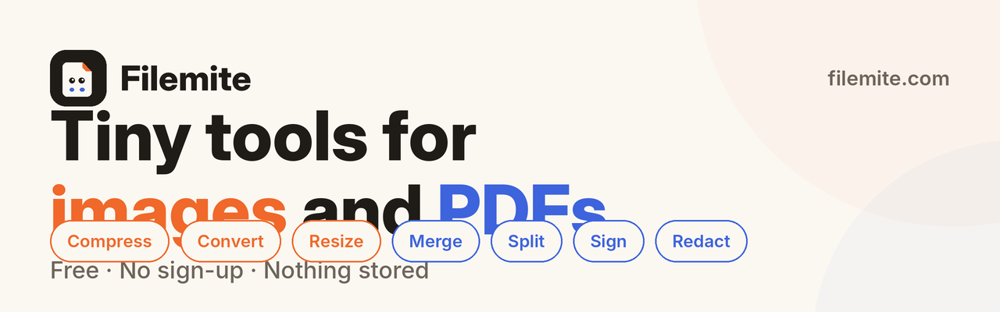

<p align="center">
  
</p>

# Filemite

Live at [filemite.com](https://filemite.com).

Small, fast tools for images and PDFs — one app, one design system.

| Image tools (server, in memory, unless marked *browser*) | PDF tools (in the browser) |
| --- | --- |
| **Compress** — PNG, JPEG, WebP, HEIC; batch of 10; Best / Balanced / Smallest | **Merge** — drag to reorder; links, forms and bookmarks kept |
| **Convert** — HEIC, PNG, JPEG, WebP to JPG, PNG or WebP at full size | **Split** — every N pages, custom ranges, or click to cut |
| **Resize** — exact pixels or presets; cover / contain / fit / stretch | **Extract** — keep or remove pages; `1-3, 8, 10-z` ranges |
| **Smart crop** — content-aware crops for social formats *(browser)* | **Compress** — by quality or to a target size; text stays sharp |
| **Rotate & flip** — quarter turns and mirrors at full resolution *(browser)* | **Organize** — rotate pages and drag them into a new order |
| **Blur & redact** — black box, pixelate or blur; hidden pixels are really replaced *(browser)* | **Images to PDF** — JPG, PNG, WebP to one PDF; A4, Letter or fit-to-image |
| **Watermark** — text or logo, placed once or tiled *(browser)* | **PDF to images** — pages as PNG or JPG at 72–300 dpi, as a ZIP |
| **Remove metadata** — shows then strips EXIF, GPS, XMP, IPTC | **Sign** — draw, type or upload a signature and place it on a page |
| **Color palette** — HEX / RGB / HSL, copy as CSS variables *(browser)* | **Fill & annotate** — text, check marks, highlights, shapes, arrows, freehand, numbered steps |
| **Favicon** — 16–256 px PNGs, `favicon.ico`, Apple touch icon | **Redact** — text, images and line art under a box are deleted from the file |
| **Collage** — grid, feature, row and column layouts *(browser)* | |
| **GIF maker** — frames to an animated GIF, bounce and loop options *(browser)* | |
| **Passport photo** — 300 dpi crops for common sizes and 4×6 / 5×7 / A4 print sheets *(browser)* | |
| **Screenshot beautifier** — gradient backdrop, padding, shadow, window bar *(browser)* | |
| **Annotate** — arrows, boxes, text, highlights, freehand and numbered steps *(browser)* | |

Images sent to the server are processed in memory with [Sharp](https://sharp.pixelplumbing.com/) and never stored. PDFs never leave the device: they're handled by [MuPDF](https://mupdf.com) compiled to WebAssembly, running in Web Workers.

## Project layout

```
src/
  routes/                 file-based routes (TanStack Start)
    image/*, pdf/*        one route per tool
    api/image/*           compress, scrub, favicon endpoints (guarded)
  features/
    image/                image tools, API client, helpers
    pdf/                  PDF tools, MuPDF engine + worker, compression pipeline
  components/
    shell/                header (section switcher + tool tabs), footer, theme
    markup/               on-picture editor (marks, handles, tool palette) shared by Annotate, Sign and Redact
    tool/                 shared tool kit: layout, panels, drop zone, results
    ui/                   button, input
  server/                 Sharp pipeline, rate limiting, request guard
  lib/
    tools.ts              registry of every tool — drives nav, home, SEO, sitemap
    site.ts               brand name, URL, links (rename the product here)
    limits.ts             limits shared by client and server
  server.ts               server entry: legacy-URL redirects, security headers
```

## Design

Warm paper-and-ink neutrals with one accent per section — tangerine for image tools, cobalt for PDF tools — set by a `data-section` attribute that remaps `--primary`. Bricolage Grotesque for display, Geist for UI, Geist Mono for numbers and labels. Light, dark and system themes. Tokens live in `src/styles/app.css`.

## Protecting the server

Only the image endpoints touch the server, and every request goes through `src/server/guard.ts` before its body is read:

| Layer | Default | Response |
| --- | --- | --- |
| Batch size (browser) | 10 images per batch, 20 PDFs per merge | rejected in the UI |
| Body size (from `Content-Length`) | 4 MB file (the Compress tool handles larger files in the browser) | 413 / 411 |
| Per-IP concurrent requests (running or queued) | 2 — the browser never sends more | 429 |
| Per-IP burst bucket | 12, refills 12/min; favicon costs 3 | 429 + `Retry-After` |
| Per-IP hourly quota | 100 images/hour across all image tools | 429 + `Retry-After` |
| Global job concurrency + bounded queue | one per CPU (2–4) running, 16 queued, 20 s wait | 503 + `Retry-After` |
| Decoded pixels per image | 50 MP (decompression bombs) | 422 |
| Output dimensions / inputs | ≤ 8192 px, strict validation | 400 |

Because one visitor can hold at most 2 of the processing slots, several people are always served side by side; extra work waits in a short queue instead of piling onto the CPU. Requests rejected for concurrency or a busy server are refunded, so they don't eat into a visitor's quota.

The browser client (`src/features/image/lib/api.ts`) shares one upload limiter across every tool and batch, honours short `Retry-After` waits on 429/503, and stops a batch as soon as the hourly quota is reached instead of sending requests that would fail. The analytics proxy has its own light rate limit.

Shared numbers live in `src/lib/limits.ts`. Server values can be tuned with environment variables: `RATE_LIMIT_BURST`, `RATE_LIMIT_PER_MINUTE`, `RATE_LIMIT_PER_HOUR`, `RATE_LIMIT_IP_CONCURRENCY`, `IMAGE_JOB_CONCURRENCY`, `IMAGE_JOB_QUEUE`, `IMAGE_JOB_QUEUE_TIMEOUT_MS`.

Burst, concurrency and queue limits are kept in memory per server instance — they protect that instance's CPU. The hourly quota can also be shared across every instance: set `UPSTASH_REDIS_REST_URL` and `UPSTASH_REDIS_REST_TOKEN` (or the `KV_REST_API_URL` / `KV_REST_API_TOKEN` that Vercel's Upstash integration adds) and it is counted in Redis. It fails open — if Redis is unreachable, requests are still served under the per-instance limits.

## Development

Requires Node 22+ and [pnpm](https://pnpm.io) (the version is pinned in `package.json`; `corepack enable` picks it up).

```bash
pnpm install
pnpm dev            # http://localhost:3000
pnpm build          # also generates src/routeTree.gen.ts, which typecheck needs
pnpm typecheck
pnpm lint
pnpm test           # Vitest: server guard, Sharp pipeline, PDF operations
pnpm test:e2e       # Playwright against the production build (run pnpm build first)
pnpm start          # serve the production build
```

The first time, run `pnpm exec playwright install chromium` for the browser tests. CI (`.github/workflows/ci.yml`) runs build, typecheck, lint and unit tests, plus the browser tests in a second job, on every pull request. `GET /api/health` returns 200 once Sharp has loaded, for uptime monitors.

Optional env: `VITE_PUBLIC_POSTHOG_PROJECT_TOKEN`, `VITE_PUBLIC_POSTHOG_HOST`.

## Deployment

Built with [TanStack Start](https://tanstack.com/start) and Nitro. On Vercel the `vercel` preset is used automatically; Sharp needs the **Node.js** runtime (not Edge), and uploads stay under Vercel's ~4.5 MB body limit. Function duration is raised to 60 s in `vite.config.ts` so a busy server answers with a clean 503 instead of a platform timeout. Elsewhere `pnpm start` serves the Node build.

Old MicroPNG (`/crop`, `/resize`, …) and microPDF (`/merge`, `/split`, …) paths 301-redirect to their new homes.

## License

[GNU AGPL-3.0-or-later](LICENSE), as required by MuPDF. If you deploy a modified version you must offer its source to your users — the footer's “Source code” link (`SOURCE_URL` in `src/lib/site.ts`) is there for that.
